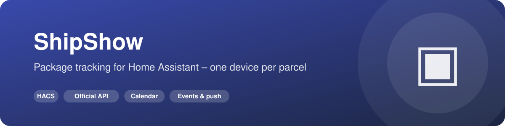
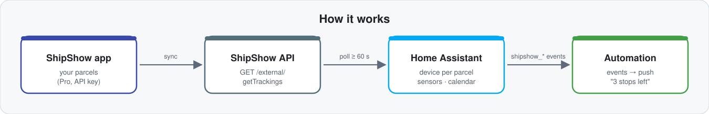
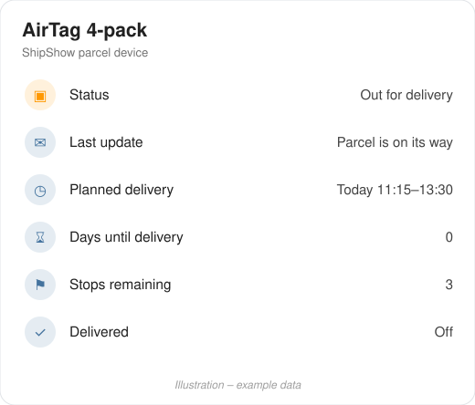
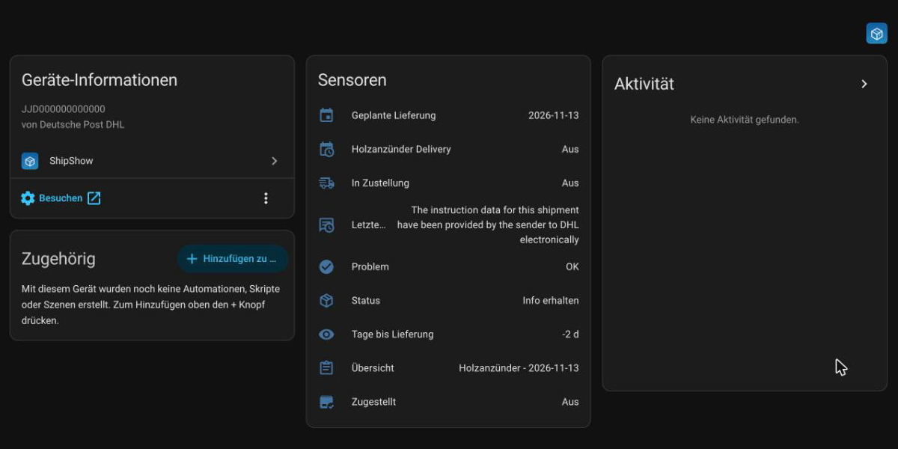

# ShipShow for Home Assistant

**English** · [Deutsch](README.de.md)

[](https://hacs.xyz)



Custom Home Assistant integration for the documented external ShipShow API. Every shipment in the ShipShow app becomes its own device with status, arrival time, remaining stops and a calendar entry.



Version `1.0.1` is compatible with Home Assistant `2026.8` and tested against `2026.8.1`. Existing entity IDs are kept during the required device and unique-ID migration.

## Features

- Setup through the Home Assistant config flow
- Uses the public endpoint `GET /external/getTrackings`
- Supports all documented query options: category, search, status filter, limit, offset via pagination, sort field and sort order
- Automatic pagination up to the configured page limit
- Global ShipShow entities on their own `ShipShow` device
- Automation-friendly sensors `ShipShow Aktuelle Lieferungen` (current deliveries) and `ShipShow Lieferübersicht` (delivery overview)
- Per shipment: status, last update, planned delivery and days until delivery
- Per shipment: binary sensors for delivered, out for delivery and problem
- Per shipment: calendar entities for planned delivery dates
- Dashboard attributes for Auto Entities: `shipshow_scope`, `shipshow_dashboard_group`, `shipshow_entity_group`, `shipshow_entity_role`
- Diagnostics with the API key redacted
- HACS metadata and GitHub validation workflows



*Illustration – example data of one shipment.*



*Real screenshot from a Home Assistant installation (German UI, personal data replaced).*

## Requirements

- ShipShow Pro subscription
- API key from the ShipShow app under Settings > API key

## Installation with HACS

1. Add this repository to HACS as a custom repository.
2. Select category `Integration`.
3. Install `ShipShow`.
4. Restart Home Assistant.
5. Open Settings > Devices & services > Add integration > ShipShow.

## Options

Set the polling interval here:

Settings > Devices & services > ShipShow > Configure > Polling interval

The value is in seconds. The minimum is 60 seconds, matching the recommendation of the public ShipShow API. After saving, Home Assistant reloads the integration and the global sensor `ShipShow Abrufintervall` shows the active value.

### Remove delivered parcels automatically

Settings > Devices & services > ShipShow > Configure > Keep delivered parcels (days)

- `0` (default): off. The option "Include delivered parcels" applies; devices of delivered parcels stay in Home Assistant as "unavailable".
- `1` or more: delivered parcels stay visible for that many days after delivery. Afterwards the integration deletes the parcel device including its sensors. Parcels that disappear from ShipShow without a delivery message are removed after the same time. The global ShipShow device is always kept.

## Naming scheme

The integration's entity names are German. Global entities belong to the `ShipShow` device, for example:

- `sensor.shipshow_lieferuebersicht` (delivery overview)
- `sensor.shipshow_aktuelle_lieferungen` (current deliveries)
- `sensor.shipshow_pakete_gesamt` (parcels total)
- `sensor.shipshow_in_zustellung` (out for delivery)
- `sensor.shipshow_abrufintervall` (polling interval)

New shipment entities get suggested entity IDs following this scheme:

- `sensor.shipshow_lieferung_<tracking_number>_status`
- `sensor.shipshow_lieferung_<tracking_number>_uebersicht` (overview)
- `sensor.shipshow_lieferung_<tracking_number>_letzte_meldung` (last update)
- `sensor.shipshow_lieferung_<tracking_number>_geplante_lieferung` (planned delivery)
- `sensor.shipshow_lieferung_<tracking_number>_tage_bis_lieferung` (days until delivery)
- `binary_sensor.shipshow_lieferung_<tracking_number>_zugestellt` (delivered)
- `binary_sensor.shipshow_lieferung_<tracking_number>_in_zustellung` (out for delivery)
- `binary_sensor.shipshow_lieferung_<tracking_number>_problem`

Home Assistant does not rename existing entity IDs automatically, for safety. The new attributes are present on existing entities too.

Each shipment is its own device in Home Assistant. Inside a shipment the entities are just called `Status`, `Letzte Meldung`, `Geplante Lieferung` and so on. This avoids duplicated names like `AirTag Joybuy ShipShow Lieferung AirTag Joybuy ...` in the UI.

## Auto Entities

All shipment entities carry these attributes:

- `shipshow_scope: lieferung`
- `shipshow_dashboard_group: shipshow_lieferungen`
- `shipshow_entity_group: shipshow_lieferung_<tracking_number>`
- `shipshow_entity_role: uebersicht`, `status`, `letzte_meldung`, `geplante_lieferung`, `tage_bis_lieferung`, `zugestellt`, `in_zustellung` or `problem`

Auto Entities card that collects all shipment entities automatically:

```yaml
type: custom:auto-entities
card:
  type: entities
  title: ShipShow deliveries
filter:
  include:
    - attributes:
        shipshow_dashboard_group: shipshow_lieferungen
sort:
  method: attribute
  attribute: shipshow_entity_group
```

Clickable shipment overview:

```yaml
type: custom:auto-entities
card:
  type: entities
  title: ShipShow deliveries
  show_header_toggle: false
filter:
  include:
    - attributes:
        shipshow_dashboard_group: shipshow_lieferungen
        shipshow_entity_role: uebersicht
      options:
        secondary_info: last-changed
        tap_action:
          action: more-info
  exclude:
    - state: unavailable
sort:
  method: name
```

Clicking a shipment opens the more-info dialog of the overview sensor. Its attributes contain the shipment details, among others `meldung`, `sendungsnummer`, `sendungsverfolgung_url`, `verlauf`, `stopps`, `ankunft`, `ankunft_von`, `ankunft_bis`, `ankunft_geschaetzt` and `rohdaten`, when ShipShow provides them.

Global ShipShow entities:

```yaml
type: custom:auto-entities
card:
  type: entities
  title: ShipShow overview
filter:
  include:
    - attributes:
        shipshow_dashboard_group: shipshow_global
sort:
  method: name
```

## Push automation for delivery and stops

The integration fires Home Assistant events, so a single automation covers all current and future shipments.

Events:

- `shipshow_lieferung_in_zustellung`: fired when a shipment goes out for delivery.
- `shipshow_stopps_weniger`: fired when the remaining stops decrease.

Event data:

- `titel` (title)
- `sendungsnummer` (tracking number)
- `dienstleister` (carrier)
- `status`
- `meldung` (message)
- `sendungsverfolgung_url` (tracking URL)
- `stopps_verbleibend` (stops remaining)
- `ankunft`: arrival time as in the ShipShow app (estimate `ca. 11:45`, window `11:15–13:30` or a single time)
- `ankunft_von`, `ankunft_bis`, `ankunft_geschaetzt`
- `vorherige_stopps` (previous stops) for the event `shipshow_stopps_weniger`
- `benachrichtigung`: ready-made German push text

Ready-to-use automation:

```yaml
alias: ShipShow – parcel is coming
triggers:
  - trigger: event
    event_type: shipshow_lieferung_in_zustellung
  - trigger: event
    event_type: shipshow_stopps_weniger
conditions:
  # optional: only notify once 5 or fewer stops are left
  - condition: template
    value_template: >
      {{ trigger.event.data.stopps_verbleibend is none
         or trigger.event.data.stopps_verbleibend <= 5 }}
actions:
  - action: notify.mobile_app_my_phone
    data:
      title: "📦 {{ trigger.event.data.titel }}"
      message: >
        {{ trigger.event.data.titel }} is out for delivery.
        
        {{ trigger.event.data.stopps_verbleibend }} stops left.
        Arrival: {{ trigger.event.data.ankunft }}
      data:
        url: "{{ trigger.event.data.sendungsverfolgung_url }}"
        tag: "shipshow-{{ trigger.event.data.sendungsnummer }}"
mode: queued
```

(For German texts simply use `message: "{{ trigger.event.data.benachrichtigung }}"`.)

Remaining stops come from the API field `deliverystopsremaining`. ShipShow provides it for Amazon Logistics while the parcel is out for delivery (for other carriers and after delivery it is `null`). The arrival time is derived from `derivedeta` (ShipShow's estimate, Amazon only), otherwise from `earliestdeliverytime` to `scheduleddeliverytime` (window) or from `scheduleddeliverytime` alone. If `deliverystopsremaining` is missing from the response entirely (older API), the integration still searches carrier metadata, delivery-progress messages and the newest history entries for stops.

## API notes

The public API documentation at [shipshow.net/api](https://www.shipshow.net/api) documents:

- Base URL: `https://api.shipshow.net/external/`
- Endpoint: `GET /external/getTrackings`
- Authentication: query parameter `apikey`
- Recommended polling interval: not more than once per minute
- Maximum page size: 50

This integration follows the public API contract and does not use internal ShipShow web-app endpoints.

## Troubleshooting

| Problem | Fix |
|---|---|
| "Invalid API key" | Copy the key again in the ShipShow app under *Settings › API key*; a Pro subscription is required. |
| No stops | ShipShow only provides stops for Amazon Logistics while out for delivery. |
| Old parcels stay around | Set "Keep delivered parcels (days)" to 1 or more. |
| Reporting a bug | *Settings › Devices & services › ShipShow › Download diagnostics* (the API key is redacted). |

## License

MIT – see [LICENSE](LICENSE). Not an official ShipShow project.
